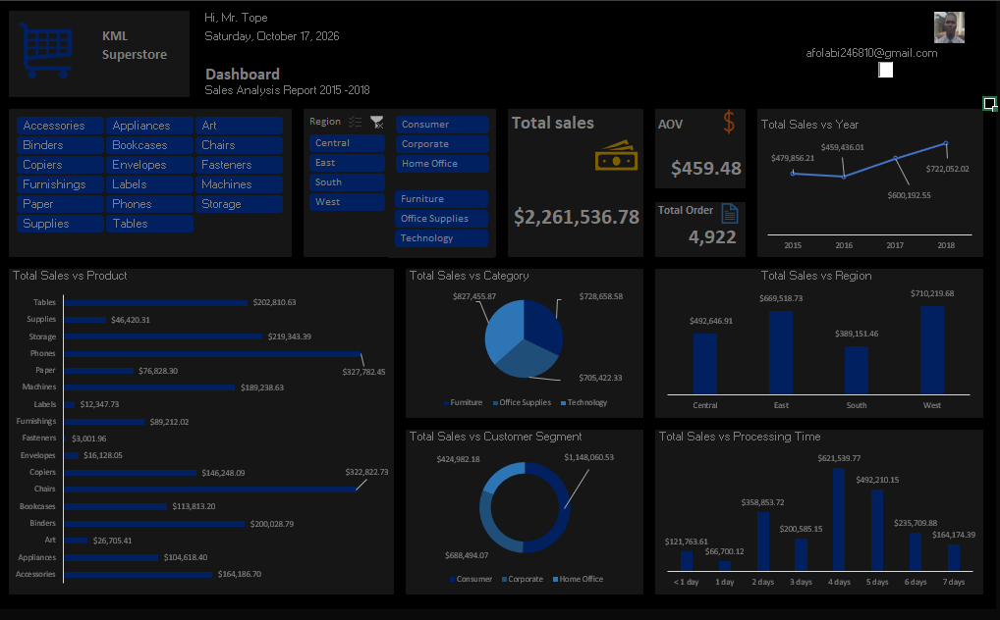
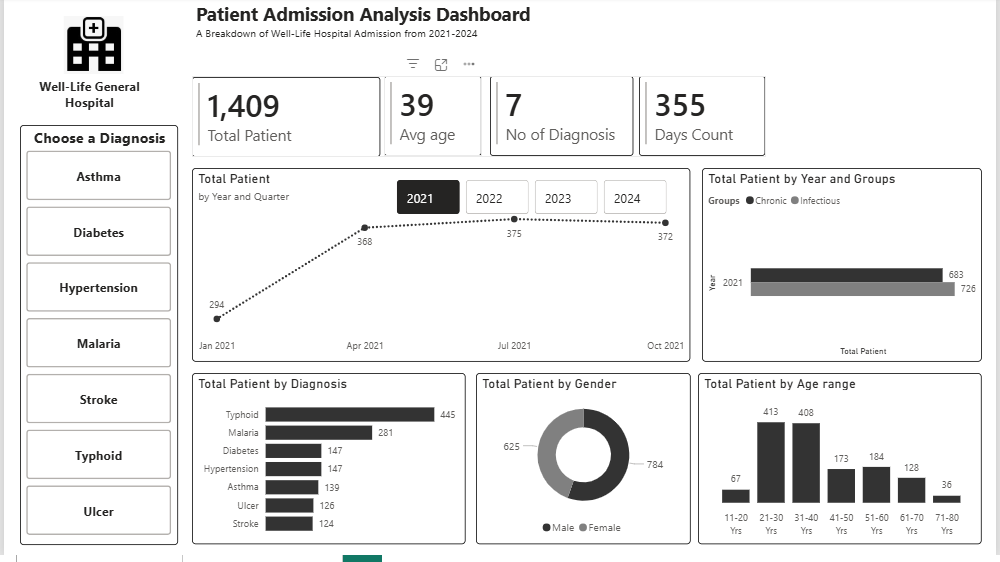

# Portfolio-
<!--Section 1: Introduce your self-->
## ABOUT ME

Hello! I'm Afolabi Temitope 🤓, a data analyst, educator, and Electrical Engineer with a zeal for turning data into insights.I help businesses solve problems and improve growth.

<!--Mention your top/relevant skills here - core and soft skills-->
## WHAT I DO

*As the Junior Analyst, I provide analytical services for businesses and also tutor beginner in the field.*

**- ✅ Data Analytics Consulting.**
I provide in-depth analysis and tailored solutions to help you make data-driven decisions, optimize processes, and drive business growth. 

**- ✅ Beginners Training & Development.**
I offer beginners training programs in data analysis, visualization, and data-driven decision-making.

<!--Section 2: List 3-4 key projects-->
## MY PORTFOLIO 

*A glimpse of some of the projects I've been working on.*

**KML Sales Analysis between year 2015 to 2018.**

My final Capstone using MS- Excel with SkillAhead Academy

[Read More](https://lnkd.in/p/etg9RFah)

**A Breakdown of Patient Record in Well-Life Hospital .**

My final Capstone using Power BI with SkillAhead Academy

## CONTACT DETAILS

*Let’s connect and see how we can make a difference together!*
<table>
  <tbody>
    <tr>
      <td>📧</td>
      <td><a href="mailto:anietieetuk@gmail.com">anietieetuk@gmail.com</a></td>
    </tr>
    <tr>
      <td>📞</td>
      <td>(234) 816-763-7212</td>
    </tr>
    <tr>
      <td>📍</td>
      <td>PH, Nigeria</td>
    </tr>
    <tr>
      <td>⬇️</td>
      <td><a href="https://etuk123456.github.io/portfolio1/docs/Profile.pdf">Download my CV</a></td>
    </tr>
    <tr>
      <td>🌐</td>
      <td><a href="https://linkedin.com/in/etukanietie">The things I do daily on LinkedIn</a></td>
    </tr>
    <tr>
      <td>📺</td>
      <td><a href="https://www.youtube.com/@LearnwithEtuk">Watch my tutorials on YouTube</a></td>
    </tr>
  </tbody>
</table>

   

